# Order Service

Order Service owns errand creation, participation and lifecycle. It coordinates credit reservation, payment and release through events, and records the credit-processing result alongside each order.

The HTTP resource is `/api/orders`; the business table is `orders.errands`, and integration events use the `Errand...Event` naming convention. **Client** in this document means an API caller. Client interactions describe the API contract rather than an implemented frontend workflow.

## Contents

1. [Service responsibilities and architecture](#1-service-responsibilities-and-architecture)
2. [Order lifecycle](#2-order-lifecycle)
3. [Business flows](#3-business-flows)
4. [Creation boundaries](#4-creation-boundaries)
5. [Queries and permissions](#5-queries-and-permissions)
6. [Concurrency and idempotency](#6-concurrency-and-idempotency)
7. [Transactions, messaging and compensation](#7-transactions-messaging-and-compensation)
8. [Database design](#8-database-design)
9. [HTTP API](#9-http-api)
10. [Event contracts](#10-event-contracts)
11. [Code organization](#11-code-organization)

## 1. Service responsibilities and architecture

Order reads and writes the same PostgreSQL order table. Spring Data JPA provides persistence and row locking; Flyway owns the schema. There is no separate read database or event-sourced order model.

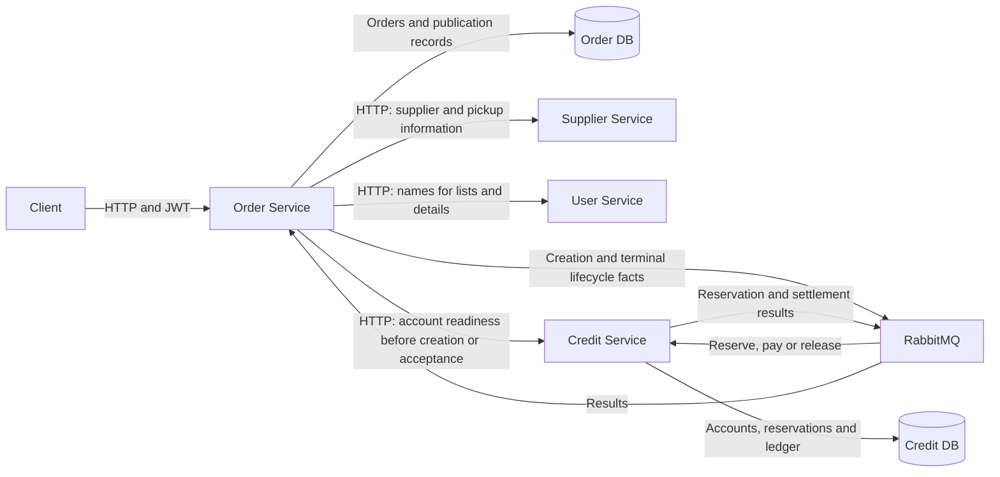

| Component | Responsibility |
| --- | --- |
| Order | Order state, participant permissions, creation idempotency, expiry and expected credit results |
| Credit | Account balances, reservation decisions, payment, release and financial idempotency |
| Supplier | Supplier existence, `active` status and pickup information |
| User | Current participant names through a batch basic-information endpoint |
| RabbitMQ | Asynchronous integration through Spring Cloud Stream |
| Spring Modulith | Transactional event-publication registration and publication recovery |

HTTP clients forward the caller's JWT. Background consumers and scheduled jobs use business identities from events and stored orders; events do not contain JWTs. Each service owns its event records and database schema.

## 2. Order lifecycle

### Order states

The diagram and transition table summarize the main lifecycle. Late reservation-result cleanup is described separately in [Section 4.4](#44-a-successful-reservation-result-arrives-after-order-expiry).

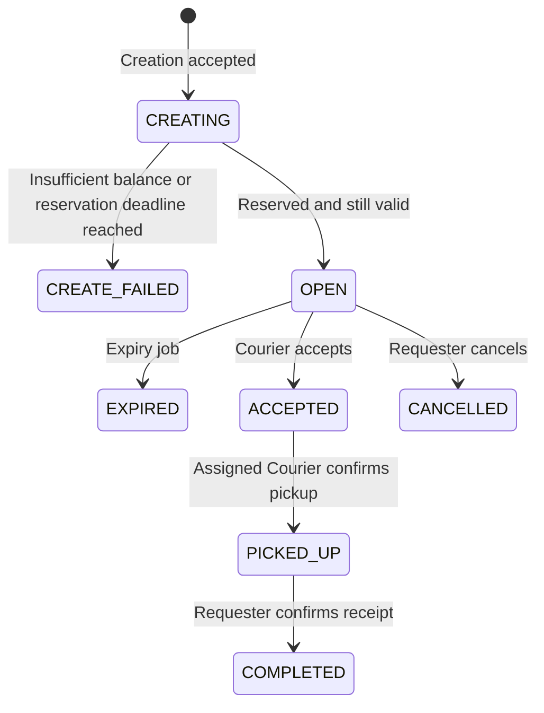

`CREATE_FAILED`, `EXPIRED`, `CANCELLED` and `COMPLETED` are terminal order states. Asynchronous credit processing can still finish after an order reaches a terminal state.

`OPEN`, `ACCEPTED`, `PICKED_UP`, `COMPLETED`, `CANCELLED` and `EXPIRED` are the six business states. `CREATING` and `CREATE_FAILED` describe internal creation progress and are visible to the Requester and ADMIN through queries.

| Transition | Trigger and conditions | Credit effect |
| --- | --- | --- |
| New request → `CREATING` | Authenticated Requester; account ready; supplier exists and is active; valid input | Publish creation fact; reservation is asynchronous |
| `CREATING` → `OPEN` | Matching `RESERVED` result; before `expires_at` | Record `RESERVED` |
| `CREATING` → `CREATE_FAILED` | Matching `INSUFFICIENT_BALANCE` or `CREATION_TIMEOUT` result | No effective reservation to release |
| `OPEN` → `ACCEPTED` | Another user with a ready account; before expiry | Keep reservation |
| `ACCEPTED` → `PICKED_UP` | Assigned Courier | Keep reservation |
| `PICKED_UP` → `COMPLETED` | Requester | Request payment to Courier |
| `OPEN` → `CANCELLED` | Requester | Request release |
| `OPEN` → `EXPIRED` | Expiry job confirms the deadline under the order lock | Request release |

Only `OPEN` orders can be cancelled or automatically expired. Accepted and picked-up orders do not expire automatically.

The Requester may repeat completion or cancellation after that same action has succeeded. Permissions are checked first; the current result is returned without another event. Other invalid lifecycle transitions return `409`.

### Credit-processing states

Order status and credit status express different facts. `COMPLETED` means receipt was confirmed; `SETTLED` means Credit confirmed payment.

| Order status | Allowed `credit_state` | Courier | `settlement_event_id` |
| --- | --- | --- | --- |
| `CREATING` | `NULL` | `NULL` | `NULL` |
| `CREATE_FAILED` | `NULL` | `NULL` | `NULL` |
| `OPEN` | `RESERVED` | `NULL` | `NULL` |
| `ACCEPTED` | `RESERVED` | Required | `NULL` |
| `PICKED_UP` | `RESERVED` | Required | `NULL` |
| `COMPLETED` | `SETTLEMENT_PENDING` or `SETTLED` | Required | Required |
| `CANCELLED` | `RELEASE_PENDING` or `RELEASED` | `NULL` | Required |
| `EXPIRED` | `RELEASE_PENDING` or `RELEASED` | `NULL` | Required |

While an order is `CREATING`, a null credit state means Order has not confirmed the reservation result. It does not prove that Credit has not reserved funds.

## 3. Business flows

In the diagrams, “register event” means save the event publication in the same local transaction as the business change. Transport to RabbitMQ happens after that transaction commits. Post-commit publication and the HTTP response can proceed independently; the response does not wait for Credit processing.

### 3.1 Create an errand

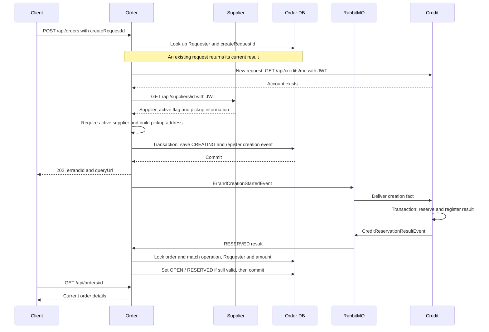

The HTTP request accepts creation without waiting for reservation. After acceptance, the message chain progresses independently of the Client. Querying progress refreshes the display; it does not drive creation.

Supplier validity is based on the active supplier returned before initial acceptance, including when ADMIN creates an order. Opening hours are not a creation restriction. The pickup name and address are saved with the order and remain fixed if the supplier later changes.

### 3.2 Accept an order and handle competing Couriers

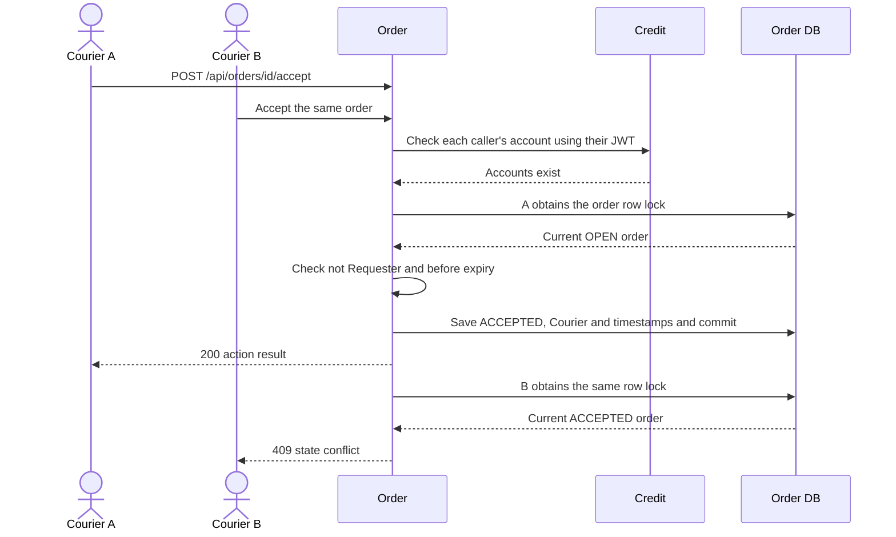

The account lookup happens before the order-lock transaction. Acceptance itself only updates Order DB; it does not transfer credits or publish an integration event.

### 3.3 Pick up

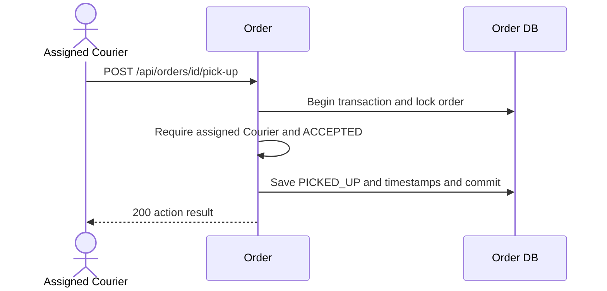

Pickup records collection of the item. The Requester must still confirm receipt before payment is requested.

### 3.4 Confirm receipt and pay the Courier


The immediate response can contain `SETTLEMENT_PENDING`. Queries expose `SETTLED` after a matching payment result is processed. Repeating completion preserves an already confirmed `SETTLED` state.

### 3.5 Cancel an open order

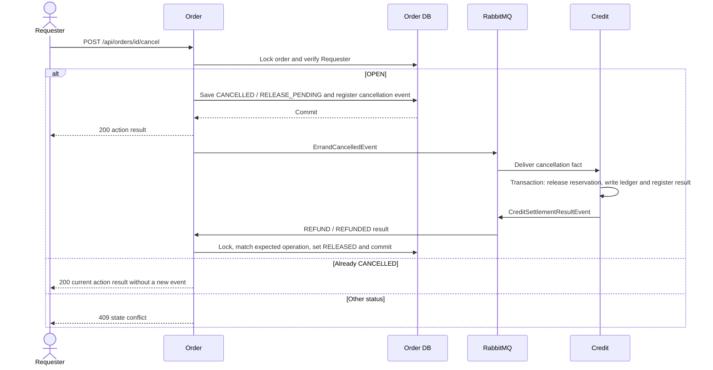

Release restores the Requester's available credits. Cancellation cannot undo an accepted order. Repeating cancellation preserves an already confirmed `RELEASED` state.

### 3.6 Expire an open order

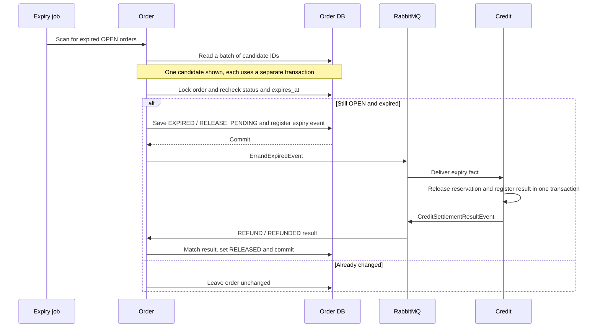

The job scans every 10 seconds by default, with a default batch size of 100. The diagram follows one candidate through its eventual release; the job does not wait for release results before processing other candidates. Acceptance checks the deadline itself, so an expired order cannot be accepted while waiting for the next scan.

## 4. Creation boundaries

### 4.1 Account readiness before creation and acceptance

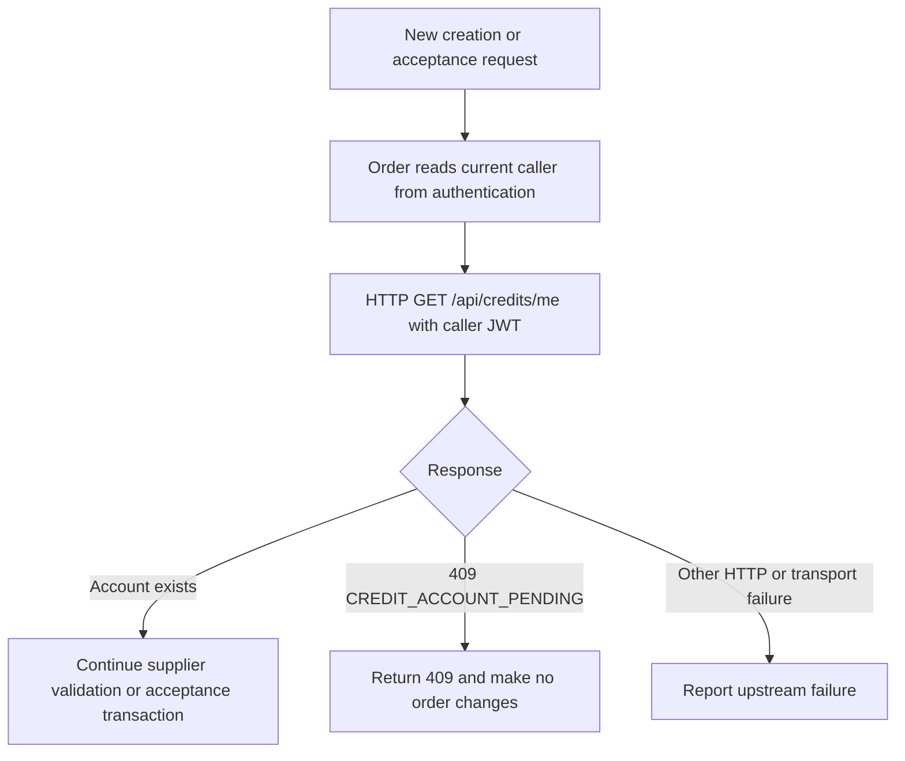

Readiness means the account exists. A zero-balance Courier can accept work; sufficient Requester balance is decided later inside the reservation transaction. An existing creation request is returned before this readiness check.

Accounts remain present after provisioning in the normal account lifecycle. Pickup, completion and cancellation do not repeat this HTTP check. A missing account encountered during background processing raises an exception and follows ordinary retry/DLQ handling; it is not reported as a normal creation timeout.

### 4.2 Duplicate submission and a lost HTTP response

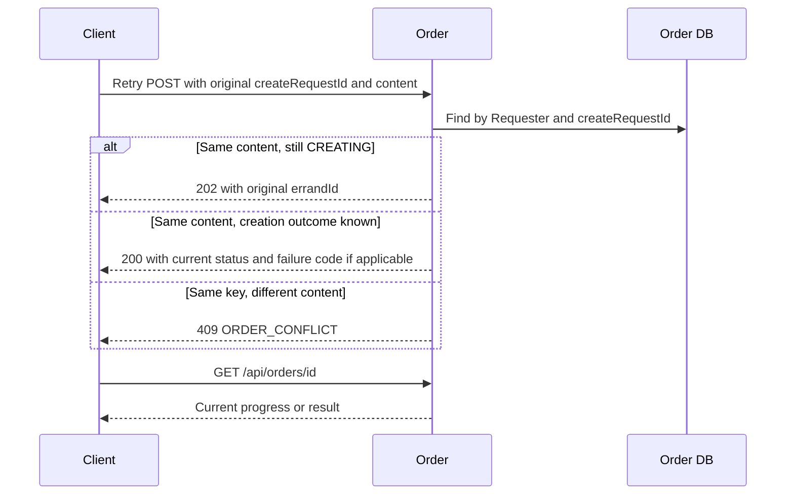

The database uniquely identifies a creation by `(requester_id, create_request_id)`. If concurrent requests both initially find no record, the unique constraint permits one insert. The losing transaction rolls back before a fresh transaction reads and compares the accepted request.

Comparison covers supplier, delivery location, description, normalized notes, reward and original expiry duration. Missing notes normalize to `""`. An accepted retry does not revalidate the supplier, create a new event or extend either deadline. Supplier validation errors are returned before insertion; the unique-conflict reread applies when insertion is attempted.

The caller should retain the request ID and original input until the result is known. A lost response does not imply failure. If no accepted record exists, the submission follows the normal new-creation path. A genuinely new creation after a definitive failure uses a new request ID.

### 4.3 Reservation deadline and order expiry

Two fixed timestamps have different responsibilities:

```text
expires_at    = created_at + expiryMinutes
reserveBefore = min(created_at + orders.creation-wait, expires_at)
```

`orders.creation-wait` defaults to **30 seconds**. Order calculates `reserveBefore` at initial acceptance and includes it in the creation event. The value stays unchanged on publication retries and message redelivery; it is not an additional order-table column.

Credit obtains the account lock, checks for an existing decision, and checks the actual current time immediately before admitting a new reservation. An existing decision takes precedence over the deadline.

| Situation | Result |
| --- | --- |
| No existing decision and `now >= reserveBefore` | Do not reserve; return `CREATION_TIMEOUT` |
| Admitted before `reserveBefore`, committed after it | Allow the transaction to finish |
| Reservation succeeded; result arrives after 30 seconds but before `expires_at` | Order can become `OPEN` |
| Reservation succeeded; result arrives at or after `expires_at` | Expire the order and release credits |
| Matching successful result is redelivered after the order advanced | Keep its current state; do not reopen it |

Publication, queueing and account-lock waits count toward the 30-second window. This rejects requests delayed too long before a new reservation, including otherwise healthy requests. It is not a guarantee that the Client receives an outcome, or that `CREATING` ends, within 30 seconds. Order waits for an explicit Credit result rather than declaring failure using a separate creation timer.

### 4.4 A successful reservation result arrives after order expiry

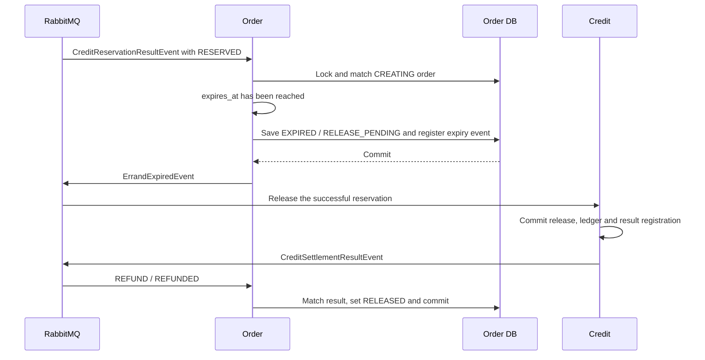

This exceptional `CREATING` → `EXPIRED` transition closes an unfinished creation whose credits were already reserved. It uses the same expiry event and release handling as an expired `OPEN` order. A definitive creation failure with no effective reservation becomes `CREATE_FAILED` and does not emit a release event.

## 5. Queries and permissions

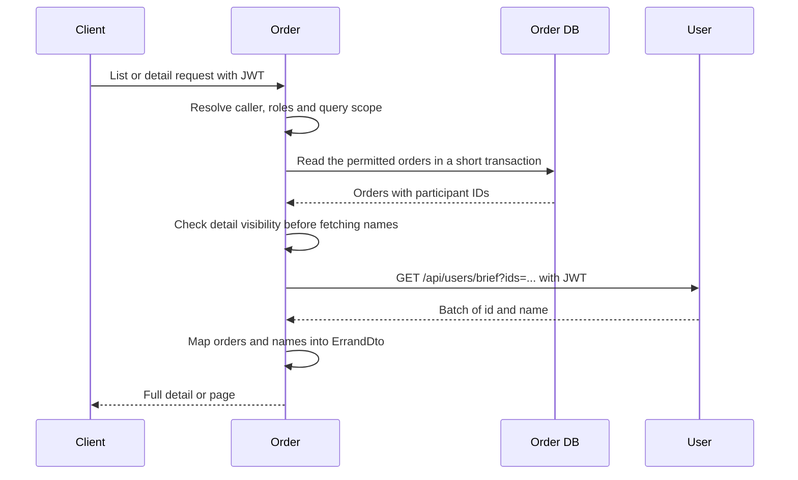

| Query | Visible records |
| --- | --- |
| Available orders | Other Requesters' `OPEN` orders with `expires_at > now` |
| My requests | Caller is Requester; includes `CREATING` and `CREATE_FAILED` |
| My Courier work | Caller is the assigned Courier |
| ADMIN query by Requester | That Requester's full history, including internal creation states |
| Detail | Requester, assigned Courier or ADMIN; another logged-in user can read an unexpired `OPEN` order |

ADMIN query privileges do not permit accepting one's own order, picking up another Courier's order, or completing/cancelling another Requester's order.

Names are current User data. Pickup name and address are order snapshots. Participant IDs are deduplicated for one batch name lookup per page; missing users are represented by their IDs with a null name. Empty results do not need a User call.

Acceptance, pickup, completion and cancellation return `ErrandActionResponse` directly from local order fields. They do not fetch names. A Client can update an already loaded order from this response and query again when it needs fresh details or an asynchronous credit result.

## 6. Concurrency and idempotency

### Row locks and short transactions

Order uses `PESSIMISTIC_WRITE` on the order row for lifecycle changes and result handling. Each operation checks the latest state after obtaining the lock. Acceptance and expiry also check the deadline under the lock.

| Competing operations | Protection |
| --- | --- |
| Two Couriers accept | First valid transition wins; the second sees `ACCEPTED` and receives `409` |
| Acceptance and cancellation/expiry | Same order lock; the next operation checks the state left by the first |
| Two completion requests | Verify Requester; only the first transition registers a completion fact |
| Repeated cancellation | Verify Requester; return current result without another release fact |
| Duplicate Credit results | Match the expected operation and confirmed state without repeating or reversing the transition |

Credit locks the Requester's account before deciding a reservation. Terminal credit handling locks the reservation; payment locks affected accounts in a consistent user-ID order. The ledger and stored reservation decision protect financial effects against redelivery.

HTTP calls happen outside order write/row-lock transactions. Broker confirmation is awaited after the business transaction commits.

### Identifier responsibilities

| Identifier | Meaning |
| --- | --- |
| `create_request_id` | Caller-generated creation key, unique within one Requester |
| Order `id` | Order identity, creation event `eventId` and reservation `operationId` |
| `settlement_event_id` | Fixed ID of the order's completion, cancellation or expiry fact |
| Result event `eventId` | Identity of that result message; a repeated decision can have a new result event ID |
| Publication-registry `id` | Framework record ID, independent of business identifiers |

Reservation results must match order ID, operation ID, Requester and amount. Settlement results must also match the expected payout/refund type and Courier, with null Courier for refunds. Only explicit matching success marks credit processing complete.

An order can produce at most one terminal lifecycle fact. Redelivery retains its original identifier and content. The flows use these identifiers and current states rather than a global message-order coordinator.

## 7. Transactions, messaging and compensation

### 7.1 Local transaction boundaries

| Transaction | Changes committed or rolled back together |
| --- | --- |
| Order accepts creation | Order record and creation-event publication registration |
| Credit reserves | Reservation decision, reserve ledger entry when successful, and result-event registration |
| Order completes/cancels/expires | Order state, expected settlement ID and terminal-event registration |
| Credit pays | Requester debit, Courier credit, reservation state, ledger and result-event registration |
| Credit releases | Reservation state, release ledger and result-event registration |
| Order processes a result | Matched order/credit-state changes and any resulting expiry-event registration |

A transaction failure undoes that service's uncommitted changes. If Order's creation transaction fails, no creation message is published from it. If Credit's ledger or result registration fails during reservation, the reservation transaction rolls back too.

Each service commits independently. If Credit committed a reservation but Order cannot save its result, the reservation remains committed while result consumption is retried. Order then opens or expires the order according to its business deadline.

### 7.2 Reliable event publication and consumption

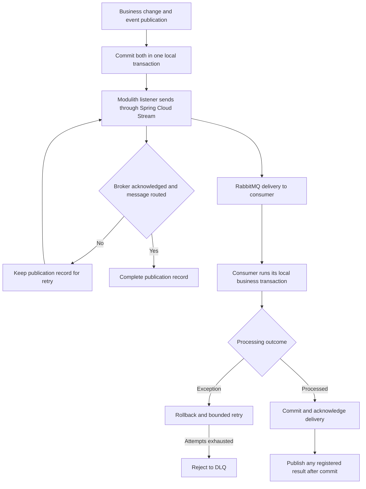

Publishers check `StreamBridge.send`, broker confirms and returned messages. Durable queues and persistent messages carry accepted publications. `required-groups` declares destination queues, and producer/consumer declarations use matching DLX/DLQ arguments.

Consumer retries allow three attempts with one- then two-second backoff. Credit's creation consumer has concurrency 3 and prefetch 1. Retries address processing errors; they are not an account-provisioning wait. Consumers tolerate duplicate deliveries instead of assuming exactly-once transport.

Each service's publication recovery job retries its own failed publication records. Order's only business-state scanning job is `OPEN` expiry; creation, pending payment and pending release progress through messages.

### 7.3 Rollback, compensation and Saga

Releasing an already committed reservation is a **compensating transaction**. Credit preserves the reserve history and records a release; it does not erase or roll back the earlier committed transaction. Cancellation, expiry and late successful creation all use this release path.

This is lightweight event-driven coordination with a choreography-style Saga compensation step. There is no separate Saga engine, central Saga coordinator or cross-service database transaction. Services react to facts and commit their own state changes.

After completion, a failed Credit payment transaction rolls back locally and is retried. The order remains `COMPLETED / SETTLEMENT_PENDING`; it is not moved back to `PICKED_UP`. Successful payment is not repeated if the same completion event is delivered again.

### 7.4 Business outcomes and processing errors

| Outcome | Handling |
| --- | --- |
| Account not ready before admission | HTTP `409/CREDIT_ACCOUNT_PENDING`; no new order or acceptance change |
| `INSUFFICIENT_BALANCE` or `CREATION_TIMEOUT` | Explicit creation result; Order records `CREATE_FAILED` |
| Normal duplicate message | Return/reconcile the original decision without repeating the financial effect |
| Database failure, malformed event or incompatible operation data | Throw, roll back, retry, then DLQ if unresolved |
| Credit reports `RESERVATION_MISMATCH`, `NO_RESERVATION` or `TERMINAL_CONFLICT` | Order logs the conflict and keeps its existing credit state; it does not report success |

DLQ retains repeatedly failing deliveries for diagnosis and replay after correction. It does not repair application code or conflicting data. Business conflicts reported in result events are recorded in logs; they do not automatically enter DLQ. Persistent failures can leave processing pending until corrected.

## 8. Database design

PostgreSQL supports local transactions, row locking, unique creation keys and the paginated lifecycle queries. The Order schema contains one business table and the Modulith publication registry. Cross-service identifiers are logical references, not database foreign keys or JPA associations.

### 8.1 Business ERD

`orders.errands` has **21 fields**. User, Supplier and Credit tables below show only the external identifiers relevant to Order.

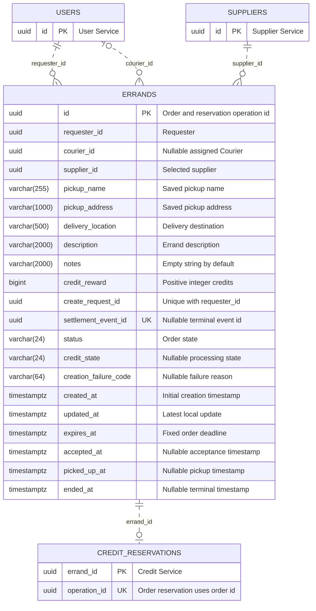

### 8.2 Fields

| Field | Nullable | Purpose |
| --- | --- | --- |
| `id` | No | Order key, creation event ID and reservation operation ID |
| `requester_id` | No | Authenticated creator |
| `courier_id` | Yes | Written on acceptance |
| `supplier_id` | No | Selected supplier |
| `pickup_name` | No | Supplier name saved at initial acceptance |
| `pickup_address` | No | Nonblank supplier building, floor and location description joined with commas |
| `delivery_location` | No | Requested delivery destination |
| `description` | No | Errand description |
| `notes` | No | Optional input normalized to an empty string |
| `credit_reward` | No | Positive whole-number reward, mapped to Credit `amount` |
| `create_request_id` | No | Requester's stable creation-submission key |
| `settlement_event_id` | Yes | Completion, cancellation or expiry event ID |
| `status` | No | One of the eight order/progress states |
| `credit_state` | Yes | Reservation, payment or release progress |
| `creation_failure_code` | Yes | `INSUFFICIENT_BALANCE` or `CREATION_TIMEOUT` for `CREATE_FAILED` |
| `created_at` | No | Fixed at first acceptance |
| `updated_at` | No | Latest local change |
| `expires_at` | No | `created_at` plus requested duration; unchanged on retries |
| `accepted_at` | Yes | Acceptance time |
| `picked_up_at` | Yes | Pickup time |
| `ended_at` | Yes | Completion, cancellation, expiry or definitive creation-failure time |

Application-generated UUIDs identify orders and operations. Timestamps use `TIMESTAMPTZ`; Order generates related timestamps from the same UTC clock with microsecond precision.

Requester/Courier names and the requested expiry duration are not stored as extra columns. The original duration is compared using `created_at` and `expires_at`; participant names are read from User. Pickup information is stored because it represents the agreed collection point.

### 8.3 Constraints and indexes

| Constraint | Rule |
| --- | --- |
| Primary key | `id` |
| Creation uniqueness | `(requester_id, create_request_id)` |
| Nullable unique terminal ID | `settlement_event_id` |
| Reward | `credit_reward > 0` |
| Deadline | `expires_at > created_at` |
| Participants | Courier is null or differs from Requester |
| Order/credit state | Only combinations in the lifecycle table are allowed, with explicit null handling |
| Courier presence | Required exactly for `ACCEPTED`, `PICKED_UP` and `COMPLETED` |
| Terminal event presence | Required exactly for `COMPLETED`, `CANCELLED` and `EXPIRED` |
| Failure reason | Required exactly for `CREATE_FAILED` |

Service logic enforces permissions and historical transitions; database checks protect the stored row from contradictory field combinations. Related status, credit state and terminal ID changes are saved together. Service logic also maintains lifecycle timestamps without duplicating every timestamp combination in SQL checks.

In addition to primary/unique indexes, the table has:

| Index | Query |
| --- | --- |
| `(requester_id, created_at DESC)` | My requests and ADMIN's Requester history |
| `(courier_id, created_at DESC)` | My Courier work |
| `(created_at DESC) WHERE status='OPEN'` | Available orders |
| `(expires_at) WHERE status='OPEN'` | Expiry candidates |

### 8.4 Event-publication registry

`orders.event_publication` is the framework's nine-field technical table. It stores the serialized event while publication is pending, independently of the order's business state.

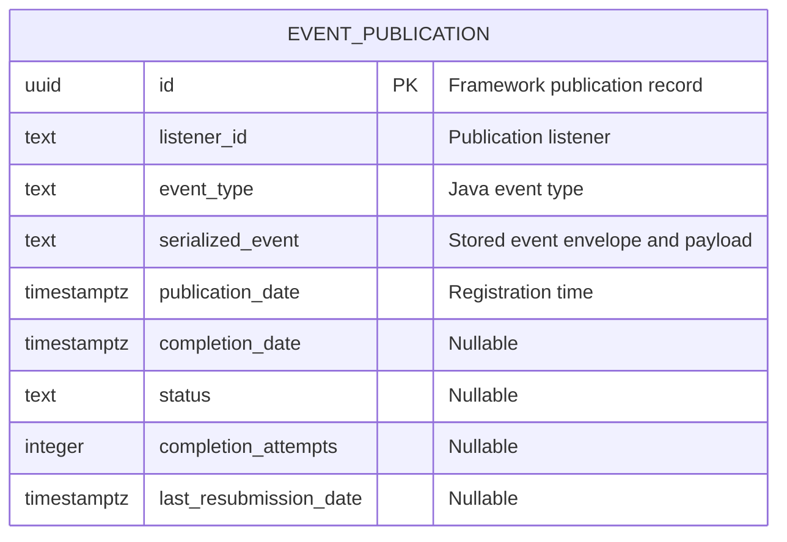

The table has indexes on the serialized-event hash and completion date. Business changes and publication registration commit together. Successfully completed publication records are deleted; durable broker queues retain delivered messages. Publication completion means transport succeeded, not that reservation or settlement finished.

The registry ID is not referenced by `errands.id` or `settlement_event_id`. The stored creation message includes its original `reserveBefore`, so retries do not recalculate it from current configuration.

## 9. HTTP API

All business endpoints require JWT authentication. The controller resource is `/orders`, and the service context path produces `/api/orders`.

### 9.1 Endpoints

| Method | Path | Permission and behavior |
| --- | --- | --- |
| POST | `/api/orders` | New creation requires ready account and active supplier; return `202` on acceptance |
| GET | `/api/orders` | Other Requesters' unexpired `OPEN` orders |
| GET | `/api/orders?requesterId={id}` | ADMIN only; specified Requester's full history |
| GET | `/api/orders/mine?as=requester` | Caller's requests, including creation progress and failures |
| GET | `/api/orders/mine?as=courier` | Caller's assigned work |
| GET | `/api/orders/{id}` | Detail subject to query visibility rules |
| POST | `/api/orders/{id}/accept` | Ready account, another Requester's valid `OPEN` order |
| POST | `/api/orders/{id}/pick-up` | Assigned Courier; `ACCEPTED` |
| POST | `/api/orders/{id}/complete` | Requester; `PICKED_UP`, or repeat `COMPLETED` |
| POST | `/api/orders/{id}/cancel` | Requester; `OPEN`, or repeat `CANCELLED` |

List endpoints accept zero-based `page`, `size` up to 100 and `sort` over `createdAt`, `expiresAt` or `id`. Defaults are page 0, size 20, `createdAt DESC, id DESC`. An `id` tie-breaker is added if absent. `mine` defaults to `as=requester`.

### 9.2 Create request and acceptance response

```json
{
  "createRequestId": "7b5c4a19-e719-4b7a-93bb-e67dfadf7292",
  "supplierId": "22222222-2222-4222-8222-222222222222",
  "deliveryLocation": "COM1 foyer",
  "description": "Collect lunch",
  "notes": "",
  "creditReward": 5,
  "expiryMinutes": 30
}
```

`createRequestId` and `supplierId` are required UUIDs. Delivery location and description are nonblank, limited to 500 and 2,000 characters respectively. Notes are limited to 2,000 characters and normalize to `""` when omitted or null. Reward is a positive integer `long`; duration is a positive integer `int`. Fractional numbers are rejected. The server determines Requester and Courier identities from authentication.

Initial acceptance returns HTTP `202` with a `Location` header matching `queryUrl`:

```json
{
  "errandId": "0e139207-2076-444b-94a9-a7a57fbcda71",
  "status": "CREATING",
  "creationFailureCode": null,
  "queryUrl": "/api/orders/0e139207-2076-444b-94a9-a7a57fbcda71"
}
```

A matching repeated POST returns this structure with the current status: `202` while creating, otherwise `200`. A definitive failure includes `creationFailureCode`. Reusing the same key with different input returns `409`.

### 9.3 Action response

Acceptance, pickup, completion and cancellation return HTTP `200` with exactly these fields:

```json
{
  "errandId": "0e139207-2076-444b-94a9-a7a57fbcda71",
  "status": "COMPLETED",
  "creditState": "SETTLEMENT_PENDING"
}
```

### 9.4 Detail and page responses

Detail uses `id` as its order identifier; creation and action responses use `errandId`.

```json
{
  "id": "0e139207-2076-444b-94a9-a7a57fbcda71",
  "requester": {
    "id": "11111111-1111-4111-8111-111111111111",
    "name": "Alex Tan"
  },
  "courier": null,
  "supplierId": "22222222-2222-4222-8222-222222222222",
  "pickup": {
    "name": "Campus food stall",
    "address": "COM3, 1, Stall 2"
  },
  "deliveryLocation": "COM1 foyer",
  "description": "Collect lunch",
  "notes": "",
  "creditReward": 5,
  "status": "OPEN",
  "creditState": "RESERVED",
  "creationFailureCode": null,
  "createdAt": "2026-10-20T12:00:00Z",
  "updatedAt": "2026-10-20T12:00:01Z",
  "expiresAt": "2026-10-20T12:30:00Z",
  "acceptedAt": null,
  "pickedUpAt": null,
  "endedAt": null
}
```

Lists wrap detail-shaped items in `{"items": [], "total": 0, "page": 0, "size": 20}`. Courier and lifecycle timestamps become populated as the order advances. Requester/ADMIN queries can return internal creation states with a null credit state.

### 9.5 Errors

Application errors handled by `GlobalExceptionHandler` use `code` and `message`, for example:

```json
{
  "code": "CREDIT_ACCOUNT_PENDING",
  "message": "Your credit account is being prepared. Please try again shortly."
}
```

| HTTP | Application code | Meaning |
| --- | --- | --- |
| 400 | `INVALID_REQUEST` | Invalid body fields, unreadable JSON, or invalid path/query parameter types |
| 400 | `ORDER_REQUEST_FAILED` | Invalid supplier or unsupported query parameters |
| 401 | `UNAUTHENTICATED` | Authentication exception raised inside the application |
| 403 | `FORBIDDEN` | Participant or ADMIN-query permission denied |
| 404 | `ORDER_NOT_FOUND` | No such order |
| 409 | `ORDER_CONFLICT` | Invalid transition or creation key reused with different content |
| 409 | `CREDIT_ACCOUNT_PENDING` | Account is not ready; creation/acceptance was not admitted |
| 502 | `UPSTREAM_ERROR` | HTTP-client failure while retrieving service data |

Authentication-filter failures and other framework errors can use Spring's own response body. Unexpected persistence or application failures remain server errors. `CREATE_FAILED` is a stored creation outcome retrieved successfully over HTTP; it is distinct from rejection before acceptance.

## 10. Event contracts

All six contracts use an envelope containing `eventId`, `eventType`, `schemaVersion`, `occurredAt` and `payload`. Schema version is `1`. Each service keeps its own record definitions with matching JSON fields.

### 10.1 Destinations and payloads

| Event | Producer → consumer | Destination | Payload fields |
| --- | --- | --- | --- |
| `ErrandCreationStartedEvent` | Order → Credit | `foc.errand-creation-started.v1` | `errandId`, `requesterId`, `amount`, `reserveBefore` |
| `CreditReservationResultEvent` | Credit → Order | `foc.credit-reservation-result.v1` | `operationId`, `errandId`, `requesterId`, `amount`, `outcome` |
| `ErrandCompletedEvent` | Order → Credit | `foc.errand-completed.v1` | `errandId`, `requesterId`, `amount`, `courierId` |
| `ErrandCancelledEvent` | Order → Credit | `foc.errand-cancelled.v1` | `errandId`, `requesterId`, `amount` |
| `ErrandExpiredEvent` | Order → Credit | `foc.errand-expired.v1` | `errandId`, `requesterId`, `amount` |
| `CreditSettlementResultEvent` | Credit → Order | `foc.credit-settlement-result.v1` | `operationId`, `errandId`, `requesterId`, `amount`, `outcome`, `settlementType`, `courierId` |

| Consumer | Group |
| --- | --- |
| Credit creation | `credit-reservations` |
| Credit completion/cancellation/expiry | `credit-settlements` |
| Order reservation result | `order-credit-reservations` |
| Order settlement result | `order-credit-settlements` |

`ErrandCreationStartedEvent` means creation has been accepted and saved; it does not mean the order is open. Terminal order events record completed lifecycle changes, not an HTTP command to Credit.

### 10.2 Creation and reservation result

The creation event ID equals the order ID. `amount` is the immutable `credit_reward`.

```json
{
  "eventId": "0e139207-2076-444b-94a9-a7a57fbcda71",
  "eventType": "ErrandCreationStartedEvent",
  "schemaVersion": 1,
  "occurredAt": "2026-10-20T12:00:00Z",
  "payload": {
    "errandId": "0e139207-2076-444b-94a9-a7a57fbcda71",
    "requesterId": "11111111-1111-4111-8111-111111111111",
    "amount": 5,
    "reserveBefore": "2026-10-20T12:00:30Z"
  }
}
```

Credit returns its decision with a new result event ID and the original operation ID:

```json
{
  "eventId": "44444444-4444-4444-8444-444444444444",
  "eventType": "CreditReservationResultEvent",
  "schemaVersion": 1,
  "occurredAt": "2026-10-20T12:00:01Z",
  "payload": {
    "operationId": "0e139207-2076-444b-94a9-a7a57fbcda71",
    "errandId": "0e139207-2076-444b-94a9-a7a57fbcda71",
    "requesterId": "11111111-1111-4111-8111-111111111111",
    "amount": 5,
    "outcome": "RESERVED"
  }
}
```

The reservation outcomes are `RESERVED`, `INSUFFICIENT_BALANCE` and `CREATION_TIMEOUT`. Credit republishes the original decision on a repeated creation event, including after the reservation was paid or released. Order does not interpret that repeated success as permission to reopen a terminal order.

### 10.3 Completion and settlement result

The terminal event ID is saved as `settlement_event_id`:

```json
{
  "eventId": "55555555-5555-4555-8555-555555555555",
  "eventType": "ErrandCompletedEvent",
  "schemaVersion": 1,
  "occurredAt": "2026-10-20T12:05:00Z",
  "payload": {
    "errandId": "0e139207-2076-444b-94a9-a7a57fbcda71",
    "requesterId": "11111111-1111-4111-8111-111111111111",
    "amount": 5,
    "courierId": "33333333-3333-4333-8333-333333333333"
  }
}
```

Credit reports the original terminal event ID in `payload.operationId`:

```json
{
  "eventId": "66666666-6666-4666-8666-666666666666",
  "eventType": "CreditSettlementResultEvent",
  "schemaVersion": 1,
  "occurredAt": "2026-10-20T12:05:00Z",
  "payload": {
    "operationId": "55555555-5555-4555-8555-555555555555",
    "errandId": "0e139207-2076-444b-94a9-a7a57fbcda71",
    "requesterId": "11111111-1111-4111-8111-111111111111",
    "amount": 5,
    "outcome": "PAID",
    "settlementType": "PAYOUT",
    "courierId": "33333333-3333-4333-8333-333333333333"
  }
}
```

Payment success requires `PAYOUT / PAID` and the expected Courier. Release success requires `REFUND / REFUNDED` and null Courier. Conflict outcomes are `RESERVATION_MISMATCH`, `NO_RESERVATION` and `TERMINAL_CONFLICT`. The result envelope's event ID is never used as the original operation ID.

## 11. Code organization

The synchronous request path is `controller → service → repository`. `OrderService` owns both queries and lifecycle operations; mapping and transport remain separate responsibilities.

```text
order-service/
└── src/main/
    ├── java/com/cs3219/foc/order/
    │   ├── OrderServiceApplication.java
    │   ├── controller/
    │   │   └── OrderController.java
    │   ├── service/
    │   │   └── OrderService.java
    │   ├── repository/
    │   │   └── ErrandRepository.java
    │   ├── model/
    │   │   ├── entity/
    │   │   │   ├── Errand.java
    │   │   │   ├── ErrandStatus.java
    │   │   │   └── CreditState.java
    │   │   └── dto/
    │   │       ├── CreateErrandRequest.java
    │   │       ├── CreateErrandResponse.java
    │   │       ├── ErrandActionResponse.java
    │   │       ├── ErrandDto.java
    │   │       ├── ErrorResponse.java
    │   │       ├── PageDto.java
    │   │       ├── SupplierPickupDto.java
    │   │       ├── UserBriefDto.java
    │   │       └── event/
    │   │           ├── ErrandCreationStartedEvent.java
    │   │           ├── CreditReservationResultEvent.java
    │   │           ├── ErrandCompletedEvent.java
    │   │           ├── ErrandCancelledEvent.java
    │   │           ├── ErrandExpiredEvent.java
    │   │           └── CreditSettlementResultEvent.java
    │   ├── mapper/
    │   │   └── ErrandMapper.java
    │   ├── infrastructure/
    │   │   ├── client/
    │   │   │   ├── CreditClient.java
    │   │   │   ├── SupplierClient.java
    │   │   │   └── UserClient.java
    │   │   └── messaging/
    │   │       ├── producer/
    │   │       │   └── ErrandEventPublisher.java
    │   │       └── consumer/
    │   │           ├── CreditReservationResultConsumer.java
    │   │           └── CreditSettlementResultConsumer.java
    │   ├── scheduler/
    │   │   ├── ErrandExpiryJob.java
    │   │   └── EventPublicationRecoveryJob.java
    │   ├── security/
    │   │   ├── CurrentUserService.java
    │   │   ├── CurrentUser.java
    │   │   ├── AuthenticationContextService.java
    │   │   └── AuthenticatedUserResolver.java
    │   ├── config/
    │   │   ├── SecurityConfig.java
    │   │   ├── OrderProperties.java
    │   │   ├── ServiceClientProperties.java
    │   │   └── EventPublicationProperties.java
    │   └── exception/
    │       ├── CreditAccountPendingException.java
    │       ├── OrderConflictException.java
    │       ├── OrderNotFoundException.java
    │       └── GlobalExceptionHandler.java
    └── resources/
        ├── application.yaml
        ├── application-prod.yaml
        └── db/migration/
            ├── V1__create_errands.sql
            └── V2__create_event_publication_table.sql
```

| Area | Responsibility |
| --- | --- |
| `OrderController` and DTOs | HTTP binding, validation, response shapes and accepted-creation status |
| `OrderService` | Permissions, short transactions, idempotency, lifecycle changes, queries and Credit result matching |
| `ErrandRepository` | Creation-key lookup, row locks, paging and expiry candidates |
| `ErrandMapper` | Full detail mapping with supplied names and local action-response mapping |
| HTTP clients | Readiness, supplier validation data and batch names; forward caller JWT |
| Event producer | Post-commit transport with broker confirmation and returned-message checks |
| Result consumers | Validate incoming messages and delegate to the service |
| Scheduled jobs | Expire `OPEN` orders and retry failed framework publications |
| Security | JWT verification, current identity/roles and authentication context for HTTP forwarding |
| Configuration | Business deadline/batch properties, service URLs and publication-confirm/retry properties |
| Exceptions | Domain errors, account-readiness rejection and HTTP error translation |
| Flyway migrations | Business schema, constraints, indexes and framework publication registry |

Credit's creation consumer delegates to `CreditReservationService`; its result publisher sends reservation and settlement results. User's `/api/users/brief` returns only ID/name for authenticated callers. These integrations keep account ownership, financial effects and user data within their owning services.
