# Order Service

Order Service owns errand creation, participation and lifecycle. It reserves credits synchronously during creation, coordinates payment and release through events, and records the credit-processing result alongside each order.

The HTTP resource is `/api/orders`; the business table is `orders.errands`, and integration events use the `Errand...Event` naming convention. **Client** in this document means an API caller. Client interactions describe the API contract rather than an implemented frontend workflow.

## Contents

1. [Service responsibilities and architecture](#1-service-responsibilities-and-architecture)
2. [Order lifecycle](#2-order-lifecycle)
3. [Business flows](#3-business-flows)
4. [Creation boundaries](#4-creation-boundaries)
5. [Queries and permissions](#5-queries-and-permissions)
6. [Concurrency and idempotency](#6-concurrency-and-idempotency)
7. [Transactions, messaging and compensation](#7-transactions-messaging-and-compensation)
8. [Database design](#8-database-design)
9. [HTTP API](#9-http-api)
10. [Event contracts](#10-event-contracts)
11. [Code organization](#11-code-organization)

## 1. Service responsibilities and architecture

Order reads and writes the same PostgreSQL order table. Spring Data JPA provides persistence and row locking; Flyway owns the schema. There is no separate read database or event-sourced order model.

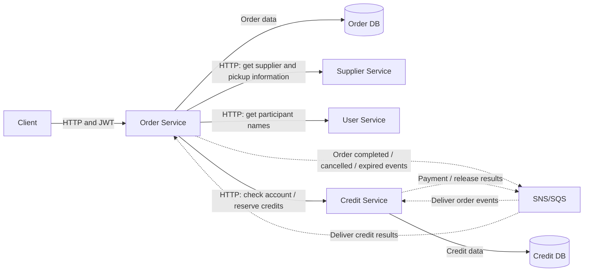

Solid arrows show synchronous HTTP calls or local database access; dotted arrows show asynchronous messages. SNS/SQS delivers order events to Credit for payment or release, then delivers Credit's results to Order to update its credit-processing state. Order commits a completion, cancellation or expiry and its event-publication registration together; the event is sent after commit.

This is a dependency overview; each request makes only the synchronous calls it needs. Participant names are fetched for lists and details. The business-flow diagrams below show execution order, and [Section 8](#8-database-design) describes the database tables.

| Component | Responsibility |
| --- | --- |
| Order | Order state, participant permissions, creation idempotency, expiry and expected credit results |
| Credit | Account balances, reservation decisions, payment, release and financial idempotency |
| Supplier | Supplier existence, `active` status and pickup information |
| User | Current participant names through a batch basic-information endpoint |
| SNS/SQS | Asynchronous integration through Spring Cloud AWS |
| Spring Modulith | Transactional event-publication registration and publication recovery |

HTTP clients forward the caller's JWT. Background consumers and scheduled jobs use business identities from events and stored orders; events do not contain JWTs. Each service owns its event records and database schema.

## 2. Order lifecycle

### Order states

The diagram and transition table summarize the main lifecycle. Exceptional expiry after synchronous reservation is described separately in [Section 4.4](#44-reservation-finishes-after-order-expiry).

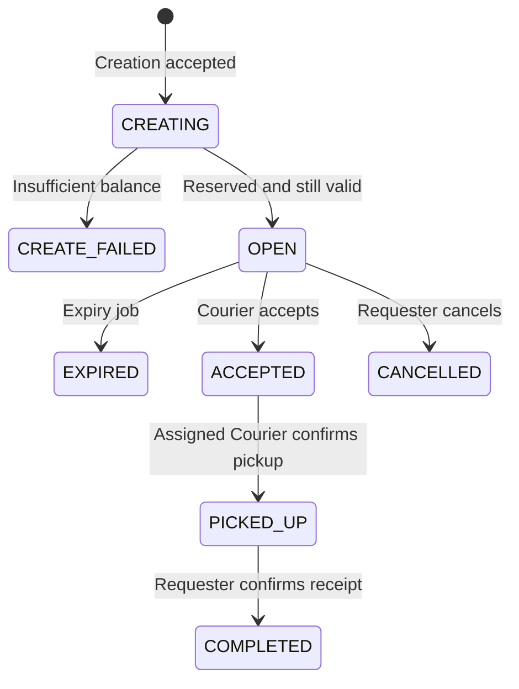

`CREATE_FAILED`, `EXPIRED`, `CANCELLED` and `COMPLETED` are terminal order states. Asynchronous credit processing can still finish after an order reaches a terminal state.

`OPEN`, `ACCEPTED`, `PICKED_UP`, `COMPLETED`, `CANCELLED` and `EXPIRED` are the six business states. `CREATING` and `CREATE_FAILED` describe internal creation progress and are visible to the Requester and ADMIN through queries.

| Transition | Trigger and conditions | Credit effect |
| --- | --- | --- |
| New request → `CREATING` | Authenticated Requester; account ready; supplier exists and is active; valid input | Save a durable record, then reserve credits over HTTP |
| `CREATING` → `OPEN` | Synchronous `RESERVED` response; before `expires_at` | Record `RESERVED` |
| `CREATING` → `CREATE_FAILED` | Synchronous `INSUFFICIENT_BALANCE` response | No effective reservation to release |
| `OPEN` → `ACCEPTED` | Another user with a ready account; before expiry | Keep reservation |
| `ACCEPTED` → `PICKED_UP` | Assigned Courier | Keep reservation |
| `PICKED_UP` → `COMPLETED` | Requester | Request payment to Courier |
| `OPEN` → `CANCELLED` | Requester | Request release |
| `OPEN` → `EXPIRED` | Expiry job confirms the deadline under the order lock | Request release |

Only `OPEN` orders can be cancelled or automatically expired. Accepted and picked-up orders do not expire automatically.

The Requester may repeat completion or cancellation after that same action has succeeded. Permissions are checked first; the current result is returned without another event. Other invalid lifecycle transitions return `409`.

### Credit-processing states

Order status and credit status express different facts. `COMPLETED` means receipt was confirmed; `SETTLED` means Credit confirmed payment.

| Order status | Allowed `credit_state` | Courier | `settlement_event_id` |
| --- | --- | --- | --- |
| `CREATING` | `NULL` | `NULL` | `NULL` |
| `CREATE_FAILED` | `NULL` | `NULL` | `NULL` |
| `OPEN` | `RESERVED` | `NULL` | `NULL` |
| `ACCEPTED` | `RESERVED` | Required | `NULL` |
| `PICKED_UP` | `RESERVED` | Required | `NULL` |
| `COMPLETED` | `SETTLEMENT_PENDING` or `SETTLED` | Required | Required |
| `CANCELLED` | `RELEASE_PENDING` or `RELEASED` | `NULL` | Required |
| `EXPIRED` | `RELEASE_PENDING` or `RELEASED` | `NULL` | Required |

While an order is `CREATING`, a null credit state means Order has not confirmed the reservation result. It does not prove that Credit has not reserved funds.

## 3. Business flows

In the diagrams, “register event” means save the event publication in the same local transaction as the business change. Transport to SNS/SQS happens after that transaction commits. For completion and cancellation, publication and the HTTP response can proceed independently. Creation waits for synchronous reservation and Order finalization.

### 3.1 Create an errand

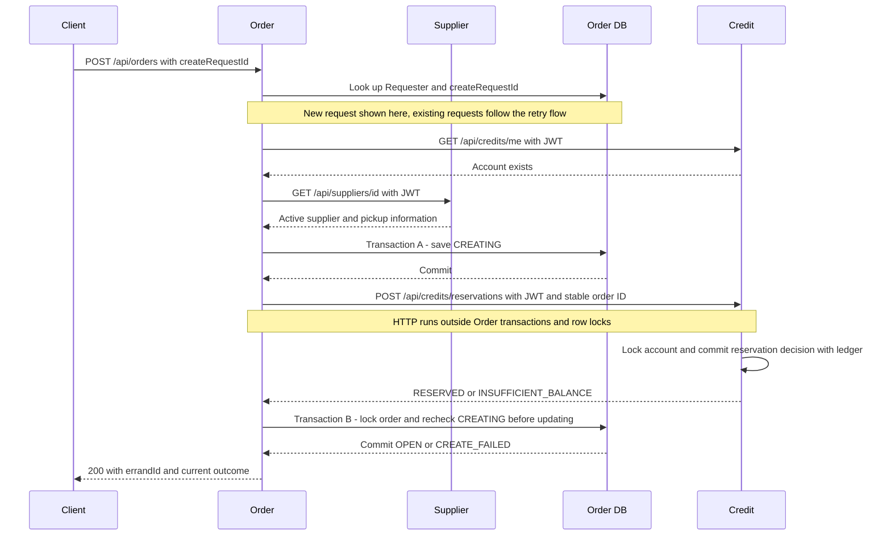

Normal creation returns after reservation and local finalization. Credit checks and reserves available balance atomically under its account lock. A separate balance read does not authorize spending.

Supplier validity is based on the active supplier returned before the initial record is saved, including when ADMIN creates an order. Opening hours are not a creation restriction. Pickup name and address remain fixed if the supplier later changes.

### 3.2 Accept an order and handle competing Couriers

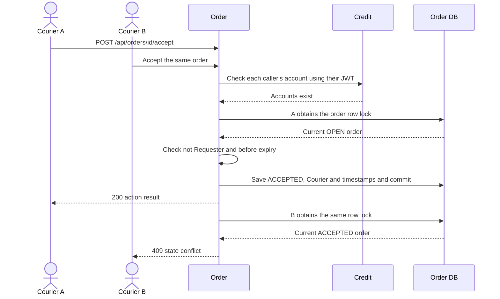

The account lookup happens before the order-lock transaction. Acceptance itself only updates Order DB; it does not transfer credits or publish an integration event.

### 3.3 Pick up

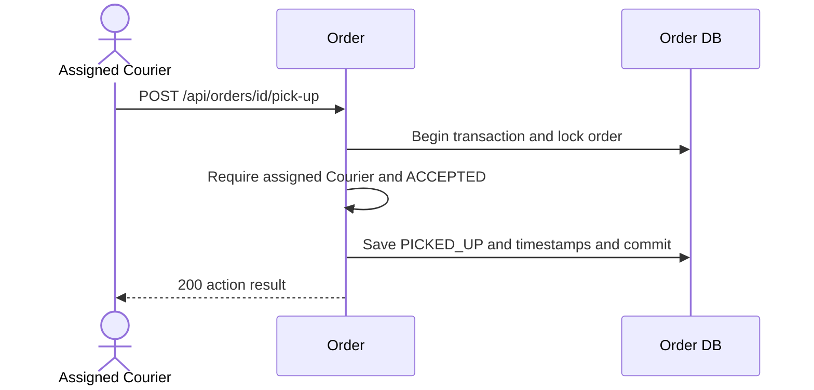

Pickup records collection of the item. The Requester must still confirm receipt before payment is requested.

### 3.4 Confirm receipt and pay the Courier

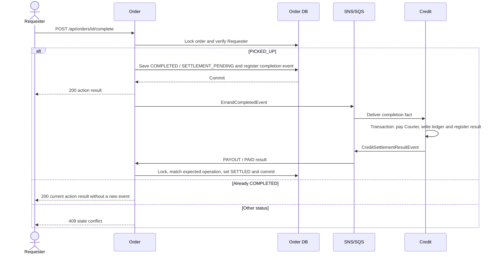

The immediate response can contain `SETTLEMENT_PENDING`. Queries expose `SETTLED` after a matching payment result is processed. Repeating completion preserves an already confirmed `SETTLED` state.

### 3.5 Cancel an open order


Release restores the Requester's available credits. Cancellation cannot undo an accepted order. Repeating cancellation preserves an already confirmed `RELEASED` state.

### 3.6 Expire an open order


The job scans every 10 seconds by default, with a default batch size of 100. The diagram follows one candidate through its eventual release; the job does not wait for release results before processing other candidates. Acceptance checks the deadline itself, so an expired order cannot be accepted while waiting for the next scan.

## 4. Creation boundaries

### 4.1 Account readiness before creation and acceptance

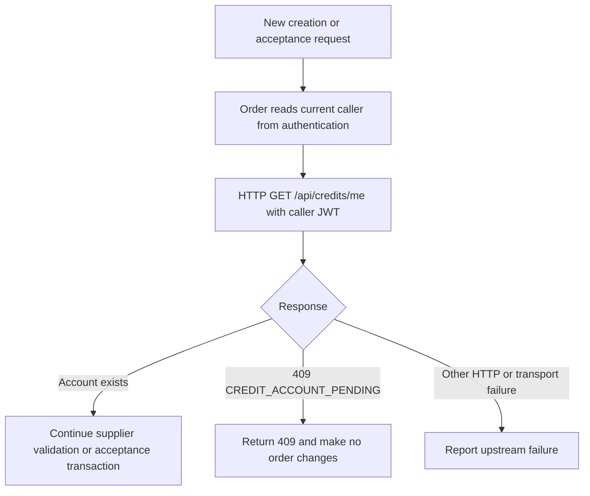

Readiness means the account exists. A zero-balance Courier can accept work; sufficient Requester balance is decided later inside the reservation transaction. Existing creation records skip this readiness lookup: `CREATING` can resume through reservation, while other states return their current result.

Accounts remain present after provisioning in the normal account lifecycle. Pickup, completion and cancellation do not repeat this HTTP check. A missing account encountered during settlement raises an exception and follows ordinary retry/DLQ handling. Creation reservation failures are HTTP errors.

### 4.2 Duplicate submission and resuming an uncertain creation

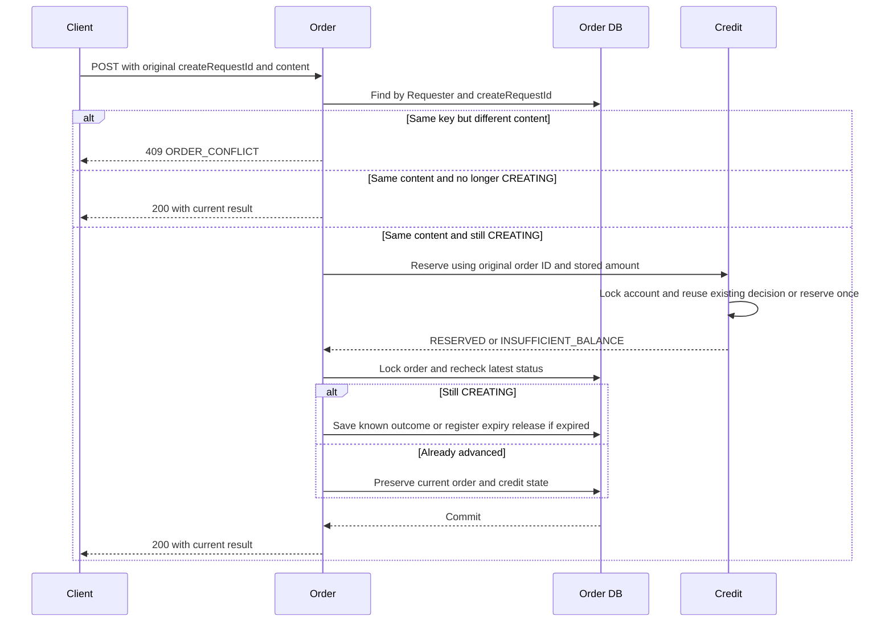

The database uniquely identifies a creation by `(requester_id, create_request_id)`. If concurrent submissions both initially find no record, only one insert succeeds. The losing insert rolls back before a fresh transaction reads and compares the original request. New records and matching `CREATING` records share the same reservation-and-finalization method.

Comparison covers supplier, delivery location, description, normalized notes, reward and original expiry duration. Missing notes normalize to `""`. A matching retry uses stored business data and does not revalidate account readiness or the supplier, change the pickup snapshot, create another order or extend expiry. Different content is rejected before another reservation call.

Multiple attempts may call Credit, always with the same operation ID, order ID and amount. Credit's account lock and stored decision prevent duplicate reservation and ledger effects. After each successful HTTP response, Order locks the row and updates only if it is still `CREATING`. An earlier or later attempt cannot reset an already open, accepted or terminal order, or overwrite confirmed settlement results.

The caller retains the request ID and original input until the outcome is known. If no record exists, a repeated submission follows normal creation. An existing `CREATING` request actively resumes over HTTP. Known outcomes return `200`, including a stored `CREATE_FAILED` decision. A genuinely new creation after a definitive failure uses a new request ID.

### 4.3 Technical failure and retrying the original creation

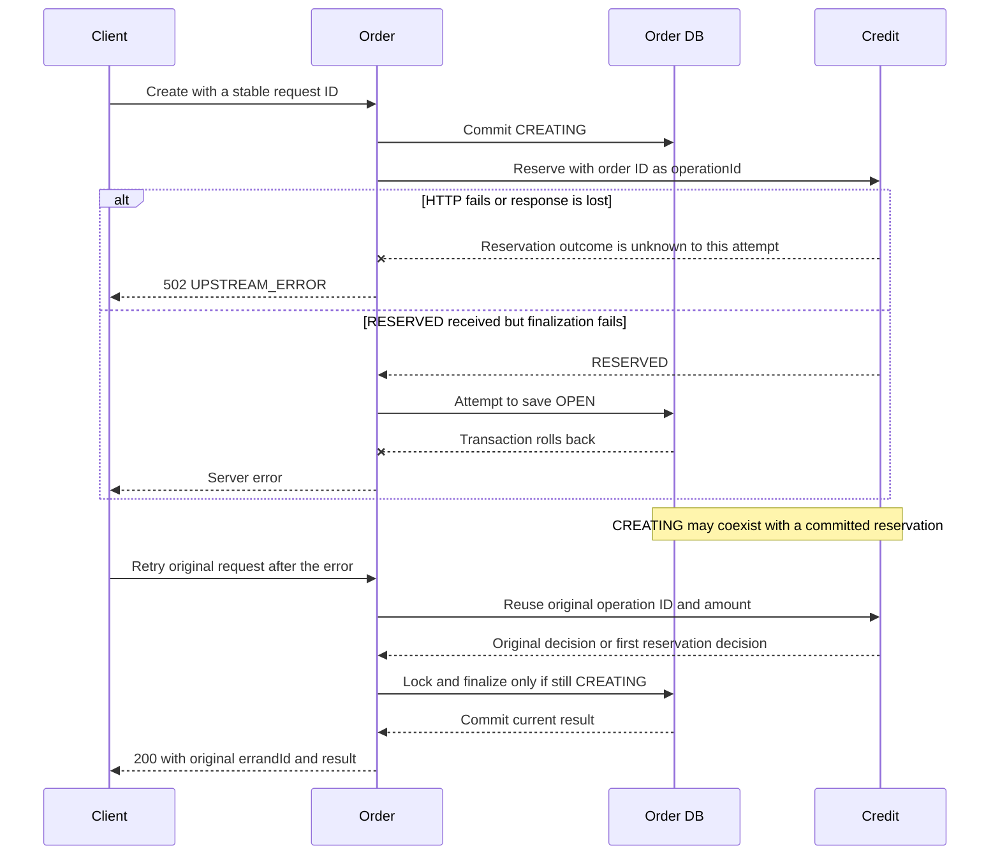

A connection failure or timeout does not prove that Credit failed. Order logs the order ID, Requester ID and creation request ID and propagates the real error without declaring a definitive failure. If no other attempt has completed creation, the record remains `CREATING` with null `credit_state`, and Credit may already have reserved funds. An interruption between the local transactions can leave the same uncertainty.

Repeat the original POST to resume the operation. An existing successful reservation is reused; a previously unprocessed reservation is attempted with the same operation ID. Queries only read state. Each retry makes one reservation HTTP call when it finds `CREATING`, outside the Order transaction, followed by a short finalization transaction. If another attempt already advanced the order, its state and settlement result are preserved.

There is no automatic creation scanner or background reservation retry. A caller who never retries, or an unresolved technical or data failure, can still leave `CREATING` and reserved funds requiring investigation.

For investigation, locate old `CREATING` records in `orders.errands`. Correlate order `id` with `credits.credit_reservations.errand_id` and `operation_id` and with `credits.credit_transaction_log.errand_id`. Compare Requester, amount and reservation state with the logged operation. Submitted business fields are stored server-side. Confirm that outstanding creation calls have finished before manual correction. An HTTP timeout alone does not establish that a refund or a new operation is safe.

`expires_at = created_at + expiryMinutes` remains the original business deadline and does not change on retry. There is no separate reservation deadline. The HTTP client has a three-second connection timeout and five-second read timeout, which bound waiting for the call, not the outcome of the remote transaction.

### 4.4 Reservation finishes after order expiry

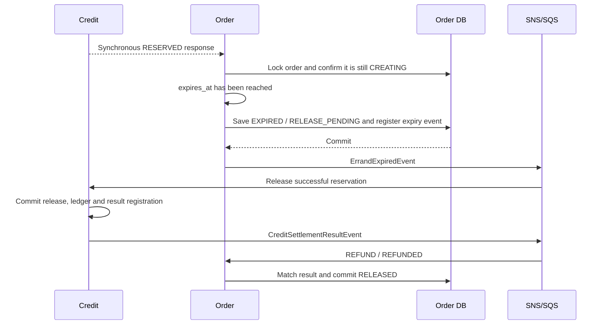

If synchronous reservation finishes after the business deadline, finalization uses the existing expiry-and-release path instead of opening an expired order. This exceptional `CREATING` → `EXPIRED` transition is separate from the main lifecycle diagram. It is not automatic recovery of an unknown result. A known insufficient-balance decision becomes `CREATE_FAILED` and emits no release event.

## 5. Queries and permissions

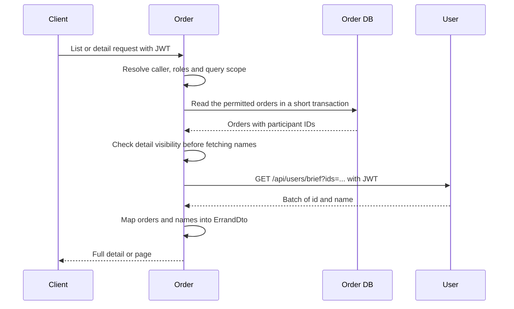

| Query | Visible records |
| --- | --- |
| Available orders | Other Requesters' `OPEN` orders with `expires_at > now` |
| My requests | Caller is Requester; includes `CREATING` and `CREATE_FAILED` |
| My Courier work | Caller is the assigned Courier |
| ADMIN query by Requester | That Requester's full history, including internal creation states |
| Detail | Requester, assigned Courier or ADMIN; another logged-in user can read an unexpired `OPEN` order |

ADMIN query privileges do not permit accepting one's own order, picking up another Courier's order, or completing/cancelling another Requester's order.

Names are current User data. Pickup name and address are order snapshots. Participant IDs are deduplicated for one batch name lookup per page; missing users are represented by their IDs with a null name. Empty results do not need a User call.

Acceptance, pickup, completion and cancellation return `ErrandActionResponse` directly from local order fields. They do not fetch names. A Client can update an already loaded order from this response and query again when it needs fresh details or an asynchronous credit result.

## 6. Concurrency and idempotency

### Row locks and short transactions

Order uses `PESSIMISTIC_WRITE` on the order row for lifecycle changes and result handling. Each operation checks the latest state after obtaining the lock. Acceptance and expiry also check the deadline under the lock.

`spring.jpa.open-in-view=false` gives each short transaction its own persistence context. After the Credit HTTP call, creation finalization loads the committed order state under the row lock. A late response therefore preserves any acceptance, completion, cancellation or expiry already committed by another request.

| Competing operations | Protection |
| --- | --- |
| Concurrent creation attempts | Same reservation operation ID and a final status check under the order lock |
| Two Couriers accept | First valid transition wins; the second sees `ACCEPTED` and receives `409` |
| Acceptance and cancellation/expiry | Same order lock; the next operation checks the state left by the first |
| Two completion requests | Verify Requester; only the first transition registers a completion fact |
| Repeated cancellation | Verify Requester; return current result without another release fact |
| Duplicate Credit results | Match the expected operation and confirmed state without repeating or reversing the transition |

Credit locks the Requester's account before deciding a reservation. Terminal credit handling locks the reservation; payment locks affected accounts in a consistent user-ID order. The ledger and stored reservation decision protect financial effects against redelivery.

HTTP calls happen outside order write/row-lock transactions. SNS publication is awaited after the business transaction commits.

### Identifier responsibilities

| Identifier | Meaning |
| --- | --- |
| `create_request_id` | Caller-generated creation key, unique within one Requester |
| Order `id` | Order identity and reservation `operationId` |
| `settlement_event_id` | Fixed ID of the order's completion, cancellation or expiry fact |
| Result event `eventId` | Identity of that result message; a repeated decision can have a new result event ID |
| Publication-registry `id` | Framework record ID, independent of business identifiers |

The reservation HTTP request carries the fixed order/operation ID and amount, with Requester identity from JWT. Settlement results must match order ID, operation ID, Requester, amount and the expected payout/refund type and Courier, with null Courier for refunds. Only explicit matching success marks credit processing complete.

`OrderService` handles payout and refund results in separate private methods. They share operation matching, conflict logging and idempotent credit-state updates within the same locked transaction.

An order can produce at most one terminal lifecycle fact. Redelivery retains its original identifier and content. The flows use these identifiers and current states rather than a global message-order coordinator.

## 7. Transactions, messaging and compensation

### 7.1 Local transaction boundaries

| Transaction | Changes committed or rolled back together |
| --- | --- |
| Order starts creation | Durable `CREATING` record and immutable submitted data |
| Credit reserves over HTTP | Reservation decision and reserve ledger entry when successful |
| Order completes/cancels/expires | Order state, expected settlement ID and terminal-event registration |
| Credit pays | Requester debit, Courier credit, reservation state, ledger and result-event registration |
| Credit releases | Reservation state, release ledger and result-event registration |
| Order finalizes creation | Known outcome and any required expiry-event registration |
| Order processes a settlement result | Matched credit-state change |

A transaction failure undoes that service's uncommitted changes. An initial insert failure without a matching accepted request prevents the Credit call; a creation-key conflict rereads and can resume the winning record. Failure of Credit's reserve-ledger insert rolls back reservation. A finalization failure rolls back only Order's final update, preserving the original `CREATING` record.

Each service commits independently. Credit's committed reservation is not rolled back by Order finalization failure. Unknown outcomes can be resumed through the original POST as described in Section 4.3. Persistent failures or records with no further retry may require investigation. No background creation retry task or asynchronous fallback is installed.

### 7.2 Reliable event publication and consumption

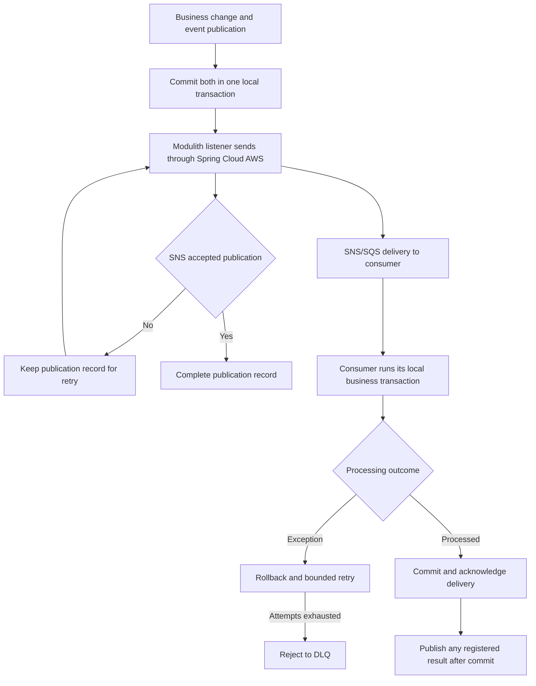

Publishers use `SnsOperations.sendNotification` and propagate publication failures to the transactional registry. An accepted SNS publish completes the publication; SNS filters route raw JSON to the subscribed SQS queue. SQS acknowledges only successful processing. Failed messages become visible again and move to the consumer’s DLQ after five receives. The Floci bootstrap provisions local topics, subscriptions, queues, and redrive configuration. Production infrastructure is added separately in [deployment PR #42](https://github.com/AY2627S1-CS3219-P24/FoC/pull/42).

Consumers tolerate duplicate deliveries.

Each service's publication recovery job retries its own failed publication records. Order's only business-state scanning job is `OPEN` expiry. Pending payment and release progress through messages. An uncertain creation can resume through the original POST; records with no further retry or persistent failures may require manual investigation.

### 7.3 Rollback, compensation and Saga

Releasing an already committed reservation is a **compensating transaction**. Credit preserves the reserve history and records a release; it does not erase or roll back the earlier committed transaction. Cancellation, expiry and synchronous reservation finishing after order expiry all use this release path.

Terminal operations use event-driven coordination with compensation; creation uses synchronous orchestration. There is no separate Saga engine, central Saga coordinator or cross-service database transaction. Services react to facts and commit their own state changes.

After completion, a failed Credit payment transaction rolls back locally and is retried. The order remains `COMPLETED / SETTLEMENT_PENDING`; it is not moved back to `PICKED_UP`. Successful payment is not repeated if the same completion event is delivered again.

### 7.4 Business outcomes and processing errors

| Outcome | Handling |
| --- | --- |
| Account not ready before admission | HTTP `409/CREDIT_ACCOUNT_PENDING`; no new order or acceptance change |
| `INSUFFICIENT_BALANCE` | Synchronous creation decision; Order records `CREATE_FAILED` |
| Creation HTTP error or failed finalization | Propagate error and retain the original record for a same-request retry or investigation |
| Normal duplicate message | Return/reconcile the original decision without repeating the financial effect |
| Database failure, malformed event or incompatible operation data during message consumption | Throw, roll back, retry, then DLQ if unresolved |
| Credit reports `RESERVATION_MISMATCH`, `NO_RESERVATION` or `TERMINAL_CONFLICT` | Order logs the conflict and keeps its existing credit state; it does not report success |

DLQ retains repeatedly failing deliveries for diagnosis and replay after correction. It does not repair application code or conflicting data. Business conflicts reported in result events are recorded in logs; they do not automatically enter DLQ. Persistent failures can leave processing pending until corrected.

## 8. Database design

PostgreSQL supports local transactions, row locking, unique creation keys and the paginated lifecycle queries. The Order schema contains one business table and the Modulith publication registry. Cross-service identifiers are logical references, not database foreign keys or JPA associations.

### 8.1 Business ERD

`orders.errands` has **21 fields**. User, Supplier and Credit tables below show only the external identifiers relevant to Order.

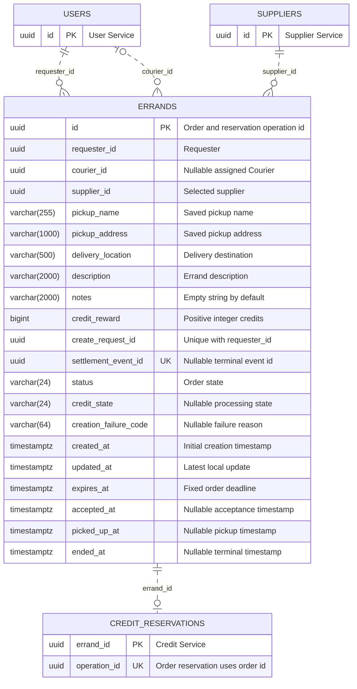

### 8.2 Fields

| Field | Nullable | Purpose |
| --- | --- | --- |
| `id` | No | Order key and reservation operation ID |
| `requester_id` | No | Authenticated creator |
| `courier_id` | Yes | Written on acceptance |
| `supplier_id` | No | Selected supplier |
| `pickup_name` | No | Supplier name saved when the creation record is first persisted |
| `pickup_address` | No | Nonblank supplier building, floor and location description joined with commas |
| `delivery_location` | No | Requested delivery destination |
| `description` | No | Errand description |
| `notes` | No | Optional input normalized to an empty string |
| `credit_reward` | No | Positive whole-number reward, mapped to Credit `amount` |
| `create_request_id` | No | Requester's stable creation-submission key |
| `settlement_event_id` | Yes | Completion, cancellation or expiry event ID |
| `status` | No | One of the eight order/progress states |
| `credit_state` | Yes | Reservation, payment or release progress |
| `creation_failure_code` | Yes | `INSUFFICIENT_BALANCE` for `CREATE_FAILED` |
| `created_at` | No | Fixed when the creation record is first persisted |
| `updated_at` | No | Latest local change |
| `expires_at` | No | `created_at` plus requested duration; unchanged on retries |
| `accepted_at` | Yes | Acceptance time |
| `picked_up_at` | Yes | Pickup time |
| `ended_at` | Yes | Completion, cancellation, expiry or definitive creation-failure time |

Application-generated UUIDs identify orders and operations. Timestamps use `TIMESTAMPTZ`; Order generates related timestamps from the same UTC clock with microsecond precision.

Requester/Courier names and the requested expiry duration are not stored as extra columns. The original duration is compared using `created_at` and `expires_at`; participant names are read from User. Pickup information is stored because it represents the agreed collection point.

### 8.3 Constraints and indexes

| Constraint | Rule |
| --- | --- |
| Primary key | `id` |
| Creation uniqueness | `(requester_id, create_request_id)` |
| Nullable unique terminal ID | `settlement_event_id` |
| Reward | `credit_reward > 0` |
| Deadline | `expires_at > created_at` |
| Participants | Courier is null or differs from Requester |

`OrderService` enforces permissions, lifecycle transitions and the state combinations in Section 2. It maintains the corresponding credit state, Courier, terminal event ID, failure reason and lifecycle timestamps together in each local transaction. These workflow rules are verified by lifecycle tests rather than duplicated in database `CHECK` constraints. The database retains the basic data constraints listed above.

In addition to primary/unique indexes, the table has:

| Index | Query |
| --- | --- |
| `(requester_id, created_at DESC)` | My requests and ADMIN's Requester history |
| `(courier_id, created_at DESC)` | My Courier work |
| `(created_at DESC) WHERE status='OPEN'` | Available orders |
| `(expires_at) WHERE status='OPEN'` | Expiry candidates |

### 8.4 Event-publication registry

`orders.event_publication` is the framework's nine-field technical table. It stores the serialized event while publication is pending, independently of the order's business state.

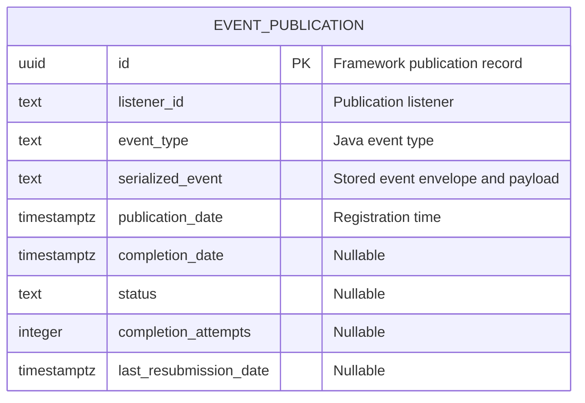

The table has indexes on the serialized-event hash and completion date. Business changes and publication registration commit together. Successfully completed publication records are deleted; durable broker queues retain delivered messages. Publication completion means transport succeeded, not that settlement finished.

The registry ID is not referenced by `errands.id` or `settlement_event_id`. Creation has no event publication entry. Terminal facts and Credit settlement results use the registry.

## 9. HTTP API

All business endpoints require JWT authentication. The controller resource is `/orders`, and the service context path produces `/api/orders`.

### 9.1 Endpoints

| Method | Path | Permission and behavior |
| --- | --- | --- |
| POST | `/api/orders` | Ready account and active supplier; reserve synchronously and return `200` with known outcome |
| GET | `/api/orders` | Other Requesters' unexpired `OPEN` orders |
| GET | `/api/orders?requesterId={id}` | ADMIN only; specified Requester's full history |
| GET | `/api/orders/mine?as=requester` | Caller's requests, including creation progress and failures |
| GET | `/api/orders/mine?as=courier` | Caller's assigned work |
| GET | `/api/orders/{id}` | Detail subject to query visibility rules |
| POST | `/api/orders/{id}/accept` | Ready account, another Requester's valid `OPEN` order |
| POST | `/api/orders/{id}/pick-up` | Assigned Courier; `ACCEPTED` |
| POST | `/api/orders/{id}/complete` | Requester; `PICKED_UP`, or repeat `COMPLETED` |
| POST | `/api/orders/{id}/cancel` | Requester; `OPEN`, or repeat `CANCELLED` |

List endpoints accept zero-based `page`, `size` up to 100 and `sort` over `createdAt`, `expiresAt` or `id`. Defaults are page 0, size 20, `createdAt DESC, id DESC`. An `id` tie-breaker is added if absent. `mine` defaults to `as=requester`.

### 9.2 Create request and response

```json
{
  "createRequestId": "7b5c4a19-e719-4b7a-93bb-e67dfadf7292",
  "supplierId": "22222222-2222-4222-8222-222222222222",
  "deliveryLocation": "COM1 foyer",
  "description": "Collect lunch",
  "notes": "",
  "creditReward": 5,
  "expiryMinutes": 30
}
```

`createRequestId` and `supplierId` are required UUIDs. Delivery location and description are nonblank, limited to 500 and 2,000 characters respectively. Notes are limited to 2,000 characters and normalize to `""` when omitted or null. Reward is a positive integer `long`; duration is a positive integer `int`. Fractional numbers are rejected. The server determines Requester and Courier identities from authentication.

Normal creation returns HTTP `200` with a `Location` header matching `queryUrl`:

```json
{
  "errandId": "0e139207-2076-444b-94a9-a7a57fbcda71",
  "status": "OPEN",
  "creationFailureCode": null,
  "queryUrl": "/api/orders/0e139207-2076-444b-94a9-a7a57fbcda71"
}
```

A matching repeated POST resumes `CREATING` using the original reservation operation ID, or returns the current result if creation has already finished. A resolved request returns `200`. Technical errors propagate as their existing HTTP error responses, and the caller can retry the original request. GET can still report `CREATING` while an attempt is in progress or unresolved. Insufficient balance returns `200 / CREATE_FAILED` with `creationFailureCode: INSUFFICIENT_BALANCE`. Reusing the same key with different input returns `409`.

### 9.3 Action response

Acceptance, pickup, completion and cancellation return HTTP `200` with exactly these fields:

```json
{
  "errandId": "0e139207-2076-444b-94a9-a7a57fbcda71",
  "status": "COMPLETED",
  "creditState": "SETTLEMENT_PENDING"
}
```

### 9.4 Detail and page responses

Detail uses `id` as its order identifier; creation and action responses use `errandId`.

```json
{
  "id": "0e139207-2076-444b-94a9-a7a57fbcda71",
  "requester": {
    "id": "11111111-1111-4111-8111-111111111111",
    "name": "Alex Tan"
  },
  "courier": null,
  "supplierId": "22222222-2222-4222-8222-222222222222",
  "pickup": {
    "name": "Campus food stall",
    "address": "COM3, 1, Stall 2"
  },
  "deliveryLocation": "COM1 foyer",
  "description": "Collect lunch",
  "notes": "",
  "creditReward": 5,
  "status": "OPEN",
  "creditState": "RESERVED",
  "creationFailureCode": null,
  "createdAt": "2026-10-20T12:00:00Z",
  "updatedAt": "2026-10-20T12:00:01Z",
  "expiresAt": "2026-10-20T12:30:00Z",
  "acceptedAt": null,
  "pickedUpAt": null,
  "endedAt": null
}
```

Lists wrap detail-shaped items in `{"items": [], "total": 0, "page": 0, "size": 20}`. Courier and lifecycle timestamps become populated as the order advances. Requester/ADMIN queries can return internal creation states with a null credit state.

### 9.5 Errors

Application errors handled by `GlobalExceptionHandler` use `code` and `message`, for example:

```json
{
  "code": "CREDIT_ACCOUNT_PENDING",
  "message": "Your credit account is being prepared. Please try again shortly."
}
```

| HTTP | Application code | Meaning |
| --- | --- | --- |
| 400 | `INVALID_REQUEST` | Invalid body fields, unreadable JSON, or invalid path/query parameter types |
| 400 | `ORDER_REQUEST_FAILED` | Invalid supplier or unsupported query parameters |
| 401 | `UNAUTHENTICATED` | Authentication exception raised inside the application |
| 403 | `FORBIDDEN` | Participant or ADMIN-query permission denied |
| 404 | `ORDER_NOT_FOUND` | No such order |
| 409 | `ORDER_CONFLICT` | Invalid transition or creation key reused with different content |
| 409 | `CREDIT_ACCOUNT_PENDING` | Account is not ready; creation/acceptance was not admitted |
| 502 | `UPSTREAM_ERROR` | HTTP-client failure while reading service data or reserving credits |

Authentication-filter failures and other framework errors can use Spring's own response body. Unexpected persistence or application failures remain server errors. `CREATE_FAILED` is a stored creation outcome retrieved successfully over HTTP; it is distinct from rejection before acceptance.

## 10. Event contracts

All four contracts use a JSON envelope containing `eventId`, `schemaVersion`, `occurredAt` and `payload`. `eventType` and `eventId` are SNS message attributes. Schema version is `1`. Each service keeps its own record definitions with matching JSON fields.

### 10.1 Destinations and payloads

| Event | Producer → consumer | Destination | Payload fields |
| --- | --- | --- | --- |
| `ErrandCompletedEvent` | Order → Credit | `Order SNS topic → Credit SQS queue` | `errandId`, `requesterId`, `amount`, `courierId` |
| `ErrandCancelledEvent` | Order → Credit | `Order SNS topic → Credit SQS queue` | `errandId`, `requesterId`, `amount` |
| `ErrandExpiredEvent` | Order → Credit | `Order SNS topic → Credit SQS queue` | `errandId`, `requesterId`, `amount` |
| `CreditSettlementResultEvent` | Credit → Order | `Credit SNS topic → Order SQS queue` | `operationId`, `errandId`, `requesterId`, `amount`, `outcome`, `settlementType`, `courierId` |

| Consumer | Queue |
| --- | --- |
| Credit completion/cancellation/expiry | `${name_prefix}-credit-events` |
| Order settlement result | `${name_prefix}-order-events` |

Terminal order events record completed lifecycle changes. Creation reservation uses HTTP and has no integration event contract.

### 10.2 Completion and settlement result

The terminal event ID is saved as `settlement_event_id`:

```json
{
  "eventId": "55555555-5555-4555-8555-555555555555",
  "schemaVersion": 1,
  "occurredAt": "2026-10-20T12:05:00Z",
  "payload": {
    "errandId": "0e139207-2076-444b-94a9-a7a57fbcda71",
    "requesterId": "11111111-1111-4111-8111-111111111111",
    "amount": 5,
    "courierId": "33333333-3333-4333-8333-333333333333"
  }
}
```

Credit reports the original terminal event ID in `payload.operationId`:

```json
{
  "eventId": "66666666-6666-4666-8666-666666666666",
  "schemaVersion": 1,
  "occurredAt": "2026-10-20T12:05:00Z",
  "payload": {
    "operationId": "55555555-5555-4555-8555-555555555555",
    "errandId": "0e139207-2076-444b-94a9-a7a57fbcda71",
    "requesterId": "11111111-1111-4111-8111-111111111111",
    "amount": 5,
    "outcome": "PAID",
    "settlementType": "PAYOUT",
    "courierId": "33333333-3333-4333-8333-333333333333"
  }
}
```

Payment success requires `PAYOUT / PAID` and the expected Courier. Release success requires `REFUND / REFUNDED` and null Courier. Conflict outcomes are `RESERVATION_MISMATCH`, `NO_RESERVATION` and `TERMINAL_CONFLICT`. The result envelope's event ID is never used as the original operation ID.

## 11. Code organization

The synchronous request path is `controller → service → repository`. `OrderService` owns both queries and lifecycle operations; mapping and transport remain separate responsibilities.

```text
order-service/
└── src/main/
    ├── java/com/cs3219/foc/order/
    │   ├── OrderServiceApplication.java
    │   ├── controller/
    │   │   └── OrderController.java
    │   ├── service/
    │   │   └── OrderService.java
    │   ├── repository/
    │   │   └── ErrandRepository.java
    │   ├── model/
    │   │   ├── entity/
    │   │   │   ├── Errand.java
    │   │   │   ├── ErrandStatus.java
    │   │   │   └── CreditState.java
    │   │   └── dto/
    │   │       ├── ReserveCreditRequest.java
    │   │       ├── CreditReservationResponse.java
    │   │       ├── CreateErrandRequest.java
    │   │       ├── CreateErrandResponse.java
    │   │       ├── ErrandActionResponse.java
    │   │       ├── ErrandDto.java
    │   │       ├── ErrorResponse.java
    │   │       ├── PageDto.java
    │   │       ├── SupplierPickupDto.java
    │   │       ├── UserBriefDto.java
    │   │       └── event/
    │   │           ├── ErrandCompletedEvent.java
    │   │           ├── ErrandCancelledEvent.java
    │   │           ├── ErrandExpiredEvent.java
    │   │           └── CreditSettlementResultEvent.java
    │   ├── mapper/
    │   │   └── ErrandMapper.java
    │   ├── infrastructure/
    │   │   ├── client/
    │   │   │   ├── CreditClient.java
    │   │   │   ├── SupplierClient.java
    │   │   │   └── UserClient.java
    │   │   └── messaging/
    │   │       ├── producer/
    │   │       │   └── SnsErrandEventPublisher.java
    │   │       └── consumer/
    │   │           └── CreditSettlementResultConsumer.java
    │   ├── scheduler/
    │   │   ├── ErrandExpiryJob.java
    │   │   └── EventPublicationRecoveryJob.java
    │   ├── security/
    │   │   ├── CurrentUserService.java
    │   │   ├── CurrentUser.java
    │   │   ├── AuthenticationContextService.java
    │   │   └── AuthenticatedUserResolver.java
    │   ├── config/
    │   │   ├── SecurityConfig.java
    │   │   ├── OrderProperties.java
    │   │   ├── ServiceClientProperties.java
    │   │   └── EventPublicationProperties.java
    │   └── exception/
    │       ├── CreditAccountPendingException.java
    │       ├── OrderConflictException.java
    │       ├── OrderNotFoundException.java
    │       └── GlobalExceptionHandler.java
    └── resources/
        ├── application.yaml
        ├── application-prod.yaml
        └── db/migration/
            ├── V1__create_errands.sql
            └── V2__create_event_publication_table.sql
```

| Area | Responsibility |
| --- | --- |
| `OrderController` and DTOs | HTTP binding, validation, synchronous creation results and Location headers |
| `OrderService` | Permissions, short transactions, idempotency, lifecycle changes, queries and Credit result matching |
| `ErrandRepository` | Creation-key lookup, row locks, paging and expiry candidates |
| `ErrandMapper` | Full detail mapping with supplied names and local action-response mapping |
| HTTP clients | Readiness, synchronous reservation, supplier data and batch names; forward caller JWT |
| Event producer | Post-commit SNS publication with failures propagated to the registry |
| Result consumers | Validate incoming messages and delegate to the service |
| Scheduled jobs | Expire `OPEN` orders and retry failed framework publications |
| Security | JWT verification, current identity/roles and authentication context for HTTP forwarding |
| Configuration | Expiry batch properties, service URLs and messaging topic/queue and publication-retry properties |
| Exceptions | Domain errors, account-readiness rejection and HTTP error translation |
| Flyway migrations | Business schema, constraints, indexes and framework publication registry |

Credit's reservation controller delegates to `CreditReservationService`; its result publisher sends settlement results. User's `/api/users/brief` returns only ID/name for authenticated callers. These integrations keep account ownership, financial effects and user data within their owning services.

## 12. Runtime configuration

Production requires `AWS_REGION`, `EVENTS_MESSAGING_TOPIC_ARN`, and `EVENTS_MESSAGING_QUEUE_NAME`. Production SNS/SQS provisioning, permissions, and runtime wiring are added separately in [deployment PR #42](https://github.com/AY2627S1-CS3219-P24/FoC/pull/42).
